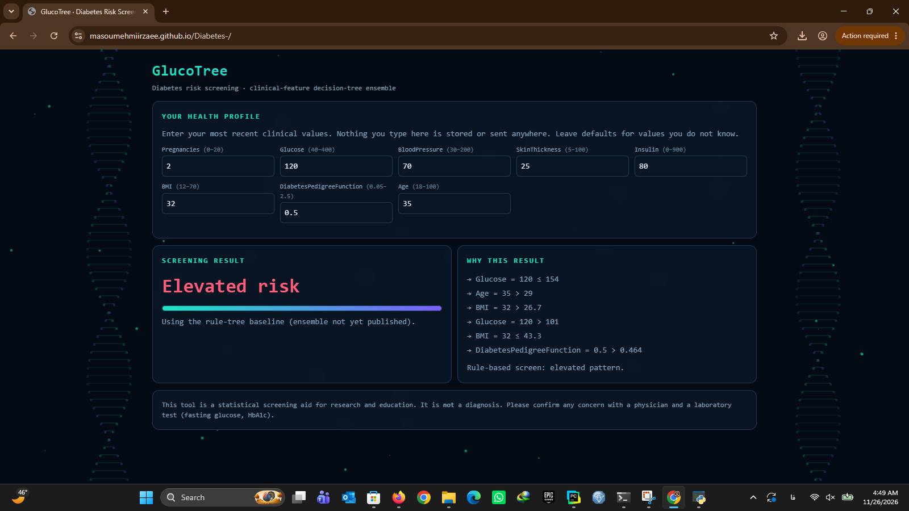

# 🌳 GlucoTree
### An Explainable Diabetes Risk Screening Tool

**GlucoTree** is an interactive web-based application designed to explore how computational approaches and rule-based decision-tree logic can support diabetes risk screening.

Developed as a hands-on learning project during my transition into **Bioinformatics and Computational Biology**, GlucoTree demonstrates how clinical and demographic data can be processed and translated into interpretable screening results.

## 🌐 Live Demo

**[Launch GlucoTree – Diabetes Risk Screening](https://masoumehmiirzaee.github.io/Diabetes-/)**

Explore the interactive application directly in your browser without installing additional software.

## 🖥️ Application Preview

<p align="center">
  
</p>
## 🎯 Project Overview

Diabetes is a complex metabolic disorder influenced by multiple clinical and demographic factors.

GlucoTree provides an educational environment where users can explore how selected health-related variables are evaluated through predefined decision rules to generate an estimated risk category.

The project focuses on the intersection of biological data, computational logic, and explainable approaches to health-related data interpretation.

## ✨ Key Features

- Interactive and user-friendly interface
- Eight clinical and demographic input variables
- Rule-based decision-tree logic
- Interpretable screening results
- Responsive web design
- Browser-based execution
- No additional software installation required

## 🧬 Input Features

The application uses eight clinical and demographic variables:

| Feature | Description |
|---|---|
| Pregnancies | Number of pregnancies |
| Glucose | Plasma glucose concentration |
| Blood Pressure | Diastolic blood pressure |
| Skin Thickness | Triceps skinfold thickness |
| Insulin | Serum insulin level |
| BMI | Body Mass Index |
| Diabetes Pedigree Function | Family-history-related diabetes risk indicator |
| Age | Age of the individual |

## ⚙️ Methodology

GlucoTree uses predefined rule-based logic inspired by decision-tree approaches.

The application evaluates the input variables through structured conditions and generates an estimated screening result.

Unlike a trained machine learning model, this implementation relies on explicitly defined rules rather than a model trained on a dataset.

This approach makes the decision process easier to understand and provides an opportunity to explore interpretable computational logic.

## 🛠️ Technologies

- **HTML5** – Application structure
- **CSS3** – Styling and responsive interface
- **JavaScript** – Input processing and decision logic
- **GitHub Pages** – Application deployment and hosting
- **GitHub** – Version control and project management

## 📂 Project Structure

```text
GlucoTree/
│
├── index.html
│
├── screenshots/
│   ├── README.md
│   └── glucotree-home.png
│
└── README.md
```

## 🚀 How to Use

1. Open the [GlucoTree Live Demo](https://masoumehmiirzaee.github.io/Diabetes-/).
2. Enter the required clinical and demographic information.
3. Provide values for the eight input variables.
4. Submit the information for evaluation.
5. Review the estimated diabetes risk screening result.

## 📊 Project Objectives

- Explore computational approaches to health-related data.
- Understand rule-based decision-tree logic.
- Develop an interactive web-based screening application.
- Connect programming concepts with Bioinformatics and Computational Biology.
- Demonstrate interpretable decision-making using clinical and demographic variables.

## ⚠️ Disclaimer

GlucoTree is an educational project developed for learning and demonstration purposes.

Its results are estimates generated through predefined rules and should not be considered medical diagnoses or substitutes for professional medical advice.

## 👩‍💻 Author

**Masoumeh Mirzaee**

GitHub: [@masoumehmiirzaee](https://github.com/masoumehmiirzaee)

## 📄 License

This project is intended for educational and demonstration purposes.
